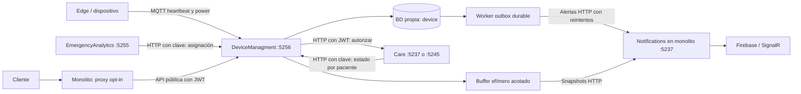

# Foll — DeviceManagment v2

## Alcance y estado

Extracción de DeviceManagment desde `../foll-backend` v2, siguiendo la organización de Care v1 y EmergencyAnalytics. Proyecto independiente .NET 10; namespace `foll_device_managment`. Este documento registra decisiones, cambios y evidencias durante la implementación.

**Exclusión solicitada por el usuario:** no implementar `Care → Devices: paciente eliminado`. No se creará receptor, emisor, evento ni worker remoto para ese caso. En modo remoto no se ejecutará el antiguo handler local sobre tablas obsoletas. El borrado de pacientes no desvinculará automáticamente los dispositivos del nuevo servicio; se requiere desvinculación explícita mientras esa integración esté pendiente.

## Propiedad del servicio

Devices es dueño del dispositivo, su asignación, batería/carga, conectividad, firmware, eventos de anomalía y su outbox. Care es dueño de pacientes y permisos; Notifications de destinatarios, push y SignalR; EmergencyAnalytics de incidentes de caídas. No se accede a las tablas de otros BC.



Estructura: `DeviceManagment/{Domain,Application,Infrastructure,Interfaces}`, `Shared` mínimo, `Migrations`, `scripts`, `tests`. El ejecutable no referencia proyectos vecinos. El proyecto de pruebas referencia el servicio y el monolito para verificar compatibilidad del proxy/adaptadores.

## Decisiones arquitectónicas

### ADR-001 — Conservar v2 y extraer por límites
Se mantienen entidades y contratos públicos v2. Se sustituyen ACL locales por gateways/adaptadores HTTP. No se reduce el dominio al alcance de Care v1. Se usa .NET 10 como en el monolito.

### ADR-002 — Sincronía por necesidad de negocio
Care se consulta por HTTP con JWT antes de vincular/desvincular o consultar mediante API pública. La consulta interna de estado para el backend Care y la asignación para Emergency son síncronas, con clave de servicio. Las alertas se entregan desde outbox durable; la telemetría en vivo usa un buffer limitado que reemplaza snapshots antiguos por el más reciente, sin crear una notificación persistente por heartbeat.

### ADR-003 — Transición opt-in
El monolito conserva el modo local por defecto. Un flag de modo remoto delegará consultas/REST y detendrá únicamente los workers locales de MQTT y conectividad. Su publicador outbox compartido continuará atendiendo mensajes de otros procesos. No se activará tráfico ni aplicarán migraciones a bases existentes durante esta implementación.

## Bitácora

### 2026-11-13 — Paso 1: inventario (completado)
- REST: vincular, desvincular, estado por dispositivo, dispositivo por paciente. Diagnóstico HTML existente sin autorización: no se migrará sin protección.
- MQTT: heartbeat y power; monitor periódico de conectividad.
- Dependencia saliente: `IPatientDeviceAcl` de Care para permiso de cuidador principal.
- Consumidores: Care agrega estado mediante `IDeviceStatusAcl`; Emergency consulta `IDeviceAssignmentAcl`.
- Alertas: LowBatteryDetected/Resolved, DeviceDisconnected/Reconnected vía outbox compartida en esquema device.
- Telemetría: publicación SignalR después de guardar heartbeat; se desacoplará para no bloquear ingestión cuando Notifications falle.
- Los cambios previos de EmergencyAnalytics ya estaban presentes al iniciar. Se conservarán. La exclusión de borrado es una instrucción explícita, no una función omitida por error.

### 2026-11-13 — Paso 2: extracción e integraciones (implementado)
- Se crearon proyecto, arranque, configuración sin secretos, Docker .NET 10 y puerto 5256. Contexto propio: devices, device_events y outbox_messages, esquema device.
- Se conservó el dominio v2; se retiró del servicio el handler/comando de desvinculación por borrado de pacientes. No se agregó una alternativa remota a ese flujo.
- Gateway a Care: GET device-access con JWT reenviado y comprobación local del cuidador principal, compatible con Care v1 y adaptador del monolito v2.
- API interna con clave de servicio: estado por paciente y asignación por dispositivo. Diagnóstico protegido y oculto de Swagger.
- Outbox de alertas HTTP: solo cuatro tipos de dispositivos, ID estable basado en OutboxMessageId, confirmación tras 2xx y parada del lote ante fallo para mantener orden. Requiere una sola réplica publicadora inicialmente.
- Telemetría: buffer con capacidad y edad máximas, reemplazo por último timestamp por dispositivo y entrega HTTP desde worker separado. No realiza HTTP en el camino de persistencia del heartbeat.
- Serialización de comandos por dispositivo mediante 256 locks acotados evita carreras MQTT/monitor/REST dentro de una réplica; el índice de paciente único protege asignaciones concurrentes entre dispositivos. No son locks distribuidos.
- MQTT aplica TLS cuando se configura, solicita QoS 1 y sesión persistente de 24h. Errores transitorios de procesamiento evitan ACK y fuerzan reconexión; la garantía depende del QoS del emisor y persistencia del broker.

### 2026-11-13 — Paso 3: transición del monolito (implementado)
- Flag `DeviceManagment:RemoteEnabled` opt-in. Proxy para API pública y adaptador `DeviceServiceClient` para ACL de asignación/estado. Care v2 conserva su respuesta agregada sin leer la BD vieja en modo remoto.
- EmergencyAnalytics puede mantener su URL al monolito, que ahora delega asignación al servicio, o apuntar directamente a :5256 con el mismo contrato.
- Se detienen únicamente MQTT/monitor locales. El publicador de outbox compartida continúa, pero excluye las cuatro clases de mensaje migradas cuando está en modo remoto. No se trasladan mensajes de eliminación remota de emergencias ni otros procesos.
- Receptor de alertas en Notifications con validación, transacción, recibos y advisory lock PostgreSQL. Reutiliza la tabla inbox de la migración anterior; no agrega tablas al monolito.
- Receptor de snapshots invoca el publicador SignalR existente; no crea notificaciones persistentes.
- El antiguo handler local de paciente eliminado se omite únicamente en modo remoto, sin enviar ninguna comunicación a Devices. La configuración local sigue funcionando por defecto.

## Validación

### 2026-11-13 — Paso 4: migraciones y verificación local
- Se generaron `InitialDeviceManagment`, snapshot y `scripts/schema.sql` sin conectar a la BD. Historial independiente: `device.__EFMigrationsHistory`.
- Compilación del nuevo servicio: correcta, sin advertencias. Monolito adaptado: correcto, con advertencias CS0168/CS0618 anteriores a esta extracción.
- Pruebas xUnit/TestHost: **29 correctas, 0 fallidas, 0 omitidas**. Cubren reglas de batería/conectividad, comandos y outbox, permisos Care, buffer limitado/caducidad, reintento con ID estable, aislamiento de BC, HTTP interno y proxy opt-in.
- `scripts/Smoke-Test.ps1`: correcto. Inicia el ejecutable real con claves sintéticas, sin workers/migraciones; verifica live, 401 en API pública/interna/diagnóstico y Swagger; cierra únicamente ese proceso.
- Se prepararon exportación/importación/verificación SQL y wrapper PowerShell con manifiesto SHA-256. No se ejecutaron contra bases de datos.
- EF confirmó que tanto el modelo de Devices como el modelo del monolito coinciden con sus migraciones; no se necesita una nueva migración adicional en el monolito por esta extracción.
- Regresión de EmergencyAnalytics: **26 pruebas correctas**, 0 fallidas. Su código/configuración no se modificó; la compatibilidad de transición se resuelve en el monolito y se documenta la opción de URL directa.
- `git diff --check` pasó. El script PowerShell de transferencia pasó la comprobación sintáctica. Care v1 permanece sin cambios. Se conservaron los cambios previos de EmergencyAnalytics existentes antes de este trabajo.
- Docker está instalado, pero el motor Linux no está iniciado; no hay psql disponible. Falta validación real de PostgreSQL, MQTT y proveedores externos. No se presenta la generación de SQL como prueba de una importación exitosa.

Comandos para repetir las verificaciones:

```powershell
dotnet restore
dotnet build Foll-DeviceManagment.csproj
dotnet test tests/Foll.DeviceManagment.Tests.csproj
./scripts/Smoke-Test.ps1
dotnet tool restore
dotnet ef migrations has-pending-model-changes
```

El manifiesto de herramienta está en `.config/dotnet-tools.json`. Durante la implementación se reutilizó el ejecutable EF instalado en `.tools` del proyecto EmergencyAnalytics; ese binario no es una dependencia del código entregado. Algunas ejecuciones requirieron autorización fuera del sandbox por fallos de inicio de PowerShell.

## Contratos para Care

Base local: **`http://localhost:5256`**.

### Consulta principal para el backend Care

```http
GET /internal/devices/patient/{patientId}/status
X-Foll-Service-Key: <clave de servicio compartida>
```

Esta ruta reemplaza `IDeviceStatusAcl` cuando Care construye su respuesta de paciente. Care debe validar que su usuario puede acceder al paciente **antes** de utilizar la clave de servicio. La clave permanece en el backend, nunca en el navegador/QR/app distribuida. Este contrato permite que Care consulte estado para cuidadores autorizados aunque la API pública v2 conserve acceso solo al cuidador principal.

Ejemplo 200 (los campos de batería/conexión/fechas pueden ser null):

```json
{
  "deviceId": 1001,
  "assignedPatientId": 25,
  "status": "Active",
  "connectivityStatus": "Connected",
  "currentBatteryLevel": 80,
  "isCharging": false,
  "lastHeartbeatAt": "2026-11-13T15:00:00Z",
  "monitoringStartedAt": "2026-11-13T14:00:00Z",
  "lastConnectivityChangeAt": "2026-11-13T14:00:00Z",
  "isOnline": true,
  "isLowBattery": false,
  "firmwareVersion": "1.0.0"
}
```

- `404`: no hay dispositivo vinculado. Care puede mostrar `isLinked=false`.
- `401`: clave ausente/incorrecta. No interpretar como paciente sin dispositivo.
- Error de red/5xx/timeout: estado no disponible; no convertirlo en una desvinculación.
- Care v2 en el monolito ya tiene el adaptador remoto preparado. Care v1 **no fue modificado**: debe incorporar su gateway si quiere enriquecer la respuesta del paciente con estos datos.

### Operaciones públicas que Care puede reenviar en nombre del usuario

| Método | Ruta | Cuerpo | Autenticación |
|---|---|---|---|
| POST | `/api/devices/{deviceId}/link` | `{ "patientId": 25 }` | JWT del usuario |
| DELETE | `/api/devices/{deviceId}/link` | Sin cuerpo | JWT del usuario |
| GET | `/api/devices/{deviceId}/status` | Sin cuerpo | JWT del usuario |
| GET | `/api/devices/patient/{patientId}` | Sin cuerpo | JWT del usuario |

Encabezado: `Authorization: Bearer <JWT de IAM>`. Se preserva la regla v2 de **cuidador principal** para estas cuatro rutas; la clave interna no la sustituye. POST/DELETE devuelven 200 con mensaje, las consultas 200 con estado, 404 si no hay resultado y 400 para errores de negocio capturados por el controlador (como en v2). JWT inválido devuelve 401.

**Care no debe llamar a ninguna ruta de paciente eliminado:** no existe en este servicio por instrucción expresa. La desvinculación DELETE anterior es una acción explícita del usuario sobre un dispositivo y sí está implementada.

### Endpoint que Care debe exponer para Devices (sentido inverso)

```http
GET /internal/patients/{patientId}/device-access
Authorization: Bearer <JWT reenviado>
```

Respuesta: `{ "patientId": 25, "officialGuardianUserId": 7 }`. Care v1 ya tiene esa ruta; el adaptador de Care v2 en el monolito también. Devices valida el ID del paciente y compara el cuidador principal con `userId` del JWT. No consulta Care por cada heartbeat: el control remoto de permisos ocurre en las operaciones de usuario.

## Otros contratos e interoperabilidad

### EmergencyAnalytics
`GET /internal/devices/{deviceId}/assignment`, clave `X-Foll-Service-Key`. Respuesta: `{ "deviceId": 1001, "assignedPatientId": 25, "status": "Active", "connectivityStatus": "Connected" }`; assignedPatientId/conectividad pueden ser null. 404 si no existe el dispositivo. Su forma coincide con el gateway de EmergencyAnalytics existente.

Para consultar directamente el nuevo servicio, configurar en EmergencyAnalytics `Services__Devices__BaseUrl=http://localhost:5256` y la misma clave interna. También puede conservar :5237: el endpoint de transición del monolito utiliza el ACL remoto cuando se activa el flag. No se cambió automáticamente la URL por defecto de EmergencyAnalytics.

### Notifications

Alertas: `POST /internal/notifications/device-events`, clave de servicio, desde outbox:

```json
{
  "eventId": "device-managment:41",
  "outboxMessageId": 41,
  "type": "device-managment.low-battery-detected.v1",
  "payload": { "DeviceId": 1001, "PatientId": 25, "BatteryLevel": 10, "ReportedAtUtc": "2026-11-13T15:00:00Z" }
}
```

Tipos permitidos: `device-managment.low-battery-detected.v1`, `device-managment.low-battery-resolved.v1`, `device-managment.device-disconnected.v1`, `device-managment.device-reconnected.v1`. Payloads conservan los records de v2; el receptor acepta enums numéricos y cadenas. Un 2xx confirma la entrega; otro resultado conserva el mensaje pendiente. El ID permanece estable en reintentos y transferencia de BD. No reiniciar secuencias ni reutilizar IDs de mensajes ya recibidos.

Snapshots: `POST /internal/notifications/device-telemetry`, clave de servicio, cuerpo `deviceId`, `patientId`, `batteryLevel`, `isCharging`, `isOnline`, `lastHeartbeatAtUtc`. Emite `device.telemetry` a grupos de cuidadores en SignalR. No crea registros de notificación ni reintenta snapshots fallidos; otro heartbeat repone la vista. El receptor ignora snapshots de más de 30s; mantener ese límite coordinado con `Telemetry:MaxAgeSeconds` del servicio.

Ambos receptores requieren que el monolito esté en modo Devices remoto; de otro modo devuelven 409. La inbox reutiliza `shared.integration_receipts` de `AddEmergencyIntegrationReceipts`. Su transacción no convierte Firebase/SignalR en efectos exactly-once: tras un fallo parcial puede haber efectos repetidos.

### MQTT

- Entrada: `foll/devices/{deviceId}/heartbeat` con `device_id`, `battery_level`, `is_charging`, `timestamp`, `firmware_version` opcional.
- Entrada: `foll/devices/{deviceId}/power` con `device_id`, `is_active`, `timestamp`.
- El device_id del payload, si se proporciona, debe coincidir con el topic.
- Batería baja: nivel menor a 15 y sin carga (configurable). Heartbeat esperado cada 10s, desconexión tras 3 intervalos, revisión cada 5s.
- El backend actualiza el snapshot y crea evento/outbox dentro del mismo SaveChanges. La actualización efímera se encola después de guardar.
- Se solicita QoS 1 y sesión persistente de 24h. El emisor y broker deben soportar/persistir ese nivel; mensajes QoS 0 no adquieren garantía durable por cambiar el suscriptor.

### Contrato preparado para evolución de asignaciones (no publicado)

Para una futura proyección local en EmergencyAnalytics se propone `device-managment.assignment-changed.v1`: `eventId`, `deviceId`, `previousPatientId`, `assignedPatientId` nullable, `assignmentVersion` monotónica por dispositivo y `occurredAtUtc`. Requiere snapshot inicial, persistir versión y consumidor idempotente/ordenado antes de reemplazar el GET actual. Este contrato se documenta; no se emiten eventos sin consumidor ni se modifica el flujo de detección de caídas en esta extracción.

## Operación, transferencia y reversión

### Configuración y arranque

Requisitos: SDK .NET 10, BD PostgreSQL **propia**, broker MQTT, Care y Notifications. Los appsettings no incluyen secretos. Puerto HTTP local 5256, Swagger `/swagger` en desarrollo, `/health/live` para proceso y `/health/ready` para verificar tablas de la BD (no la salud completa del ecosistema).

```powershell
$env:ConnectionStrings__DefaultConnection = 'Host=localhost;Port=5432;Database=foll_devices;Username=foll;Password=REEMPLAZAR'
$env:JwtSettings__Secret = 'REEMPLAZAR_POR_LA_CLAVE_REAL_DE_IAM_DE_AL_MENOS_32_BYTES'
$env:InternalApi__ApiKey = 'REEMPLAZAR_POR_UNA_CLAVE_INTERNA_ALEATORIA_DE_AL_MENOS_32_CARACTERES'
$env:Services__Care__BaseUrl = 'http://localhost:5237' # o :5245 con Care v1 y datos coherentes
$env:Services__Notifications__BaseUrl = 'http://localhost:5237'
dotnet tool restore
dotnet ef database update
dotnet run --launch-profile http
```

`database update` solo después de verificar que la cadena apunta al destino nuevo. **No se ejecutó en esta implementación.** Las migraciones automáticas están desactivadas por defecto. Para preparación sin workers: `Mqtt__Enabled=false`, `DeviceMonitoring__Enabled=false`, `Outbox__Enabled=false`, `Telemetry__Enabled=false`.

MQTT: `Mqtt__Host`, `Port`, `Username`, `Password`, `UseTls` y `ClientId`. Usar un client ID propio y estable; no compartirlo con la instancia antigua. Los timeouts HTTP se ajustan con `Services__Care__TimeoutSeconds` / `Services__Notifications__TimeoutSeconds`. Los límites de telemetría se configuran en `Telemetry`.

En el entorno del monolito:

```powershell
$env:InternalApi__ApiKey = 'MISMA_CLAVE_INTERNA_QUE_DEVICES'
$env:Services__Devices__BaseUrl = 'http://localhost:5256'
$env:DeviceManagment__RemoteEnabled = 'true'
```

El flag no se activó en los archivos existentes. Aplicar previamente la migración inbox de la entrega EmergencyAnalytics si aún no existe. El monolito mantiene migraciones automáticas por defecto: desactivarlas con `ApplyMigrationsOnStartup=false` si se exige un proceso de SQL controlado.

Care v1 no cambia por esta entrega. Para usarlo como fuente de permisos, sus IDs/pacientes deben ser coherentes con las asignaciones y con los destinatarios que aún resuelve Notifications en el monolito. Cambiar una URL no sincroniza automáticamente los datos de los BC.

### Transferencia controlada

1. Respaldar origen/configuración; crear la BD nueva y aplicar la migración inicial con todos los workers nuevos desactivados.
2. Preparar receptores/clave interna e inbox en Notifications. Mantener el monolito en modo local mientras se prueba configuración sin consumo duplicado.
3. Abrir ventana de mantenimiento: pausar vinculación/desvinculación, MQTT y monitor antiguos. Drenar las alertas pendientes cuando sea posible. Coordinar buffering/pausa de Edge para no perder mensajes durante el cambio. Congelar también el publicador compartido durante el snapshot si está procesando esos mensajes.
4. Configurar servicios libpq y pgpass fuera del repositorio. Ejecutar manualmente:

```powershell
./scripts/Transfer-DeviceData.ps1 -Mode Export -PgService foll_source -BackupDirectory 'C:/backups/devices-cutover'
./scripts/Transfer-DeviceData.ps1 -Mode Verify -PgService foll_source -BackupDirectory 'C:/backups/devices-cutover'
./scripts/Transfer-DeviceData.ps1 -Mode Import -PgService foll_devices_target -BackupDirectory 'C:/backups/devices-cutover'
./scripts/Transfer-DeviceData.ps1 -Mode Verify -PgService foll_devices_target -BackupDirectory 'C:/backups/devices-cutover'
```

La exportación usa un snapshot consistente y columnas explícitas. Incluye inventario, anomalías y **solo cuatro tipos de outbox Devices**; deja en el origen los mensajes de otros procesos, aunque compartan esquema. Conserva IDs, asignaciones, firmware, timestamps, estados de alertas y procesamiento; no traslada el historial EF del monolito.

La importación exige un destino vacío de eventos/outbox y con inventario vacío o únicamente los dos seeds intactos de la migración. Retira exclusivamente esos seeds verificados y carga el inventario real en la misma transacción. Rechaza otro inventario existente; no trunca bases. Reajusta secuencias de eventos/outbox (DeviceId no es autogenerado). Verifica checksum SHA-256 antes de cargar y rechaza eventos huérfanos/outbox ajena. Los scripts están preparados, no validados contra PostgreSQL real en este entorno.

5. Comparar conteos por tipo/estado, IDs, asignaciones, batería, último heartbeat, anomalías activas y outbox pendiente. Confirmar que los mensajes no Devices permanecen en origen.
6. Activar flag del monolito y workers del nuevo servicio. Confirmar **un solo consumidor MQTT, monitor y publicador de alertas Devices**. El publicador compartido del monolito debe seguir habilitado para el resto de mensajes; su consulta ya excluye los cuatro tipos migrados en modo remoto.
7. El tiempo de mantenimiento puede provocar que el monitor vea heartbeats antiguos y marque desconexiones. Reanudar recepción MQTT, esperar señales actuales y habilitar monitor de forma coordinada para evitar avisos provocados por la ventana.
8. Validar en integración: link → heartbeat → Care estado; batería baja/recuperación → notificación; timeout/power → desconexión/reconexión; caída → Emergency identifica paciente; Notifications fuera de servicio → ingestión continúa/outbox reintenta; ninguna ruta de borrado de paciente implementada.

### Reversión

Sin escrituras nuevas en el destino: detener workers nuevos, restaurar configuración local del monolito y reanudar origen congelado. Con escrituras nuevas: volver a mantenimiento, respaldar ambos lados, reconciliar inventario/eventos/outbox y recibos antes de reactivar tablas antiguas. Desactivar solo el flag devolvería datos viejos. El importador no implementa una fusión inversa sobre destinos con datos; la reversión posterior requiere procedimiento supervisado. No borrar inbox ni reiniciar IDs para forzar reenvíos.

### Riesgos y operación

- **Borrado de pacientes excluido:** puede quedar una asignación a un paciente eliminado. Desvincular explícitamente antes del borrado; no se ofrece garantía de limpieza automática. El endpoint directo de asignación representa lo almacenado en Devices, no consulta la existencia del paciente en cada lectura.
- Outbox durable con entrega al menos una vez y deduplicación de recepción completa. Efectos externos parcialmente ejecutados pueden repetirse. No hay leasing de outbox entre réplicas: operar inicialmente con una sola réplica. El orden global produce bloqueo de cola ante un evento problemático; monitorear RetryCount/Error/backlog y acordar tratamiento manual, no saltarlo silenciosamente.
- Telemetría es efímera: se pierde al reiniciar, caduca y se descarta ante capacidad/error. El estado persistido consultable es la recuperación; no debe usarse como canal de alertas críticas.
- Locks acotados protegen concurrencia dentro de un proceso; múltiples réplicas requerirían concurrencia optimista/distribuida. Se conservan restricciones de v2 sobre mensajes power fuera de orden y anomalías activas al desvincular/reasignar; validar esos escenarios antes de ampliar el despliegue.
- El diagnóstico exige clave interna. Red privada/HTTPS, gestión de secretos, CORS del punto de entrada y monitoreo son responsabilidades de despliegue. El JWT conserva issuer/audience de v2 para compatibilidad; endurecerlo exige coordinar IAM.
- No se desplegó ni se aplicaron migraciones, transfirieron datos o activó tráfico real.

### 2026-11-13 — Cierre de entrega local
Código extraído y adaptadores preparados; 29 pruebas Devices y 26 de regresión EmergencyAnalytics correctas. El modo remoto sigue desactivado por defecto. La aceptación operacional requiere ejecutar la lista de integración anterior con PostgreSQL/MQTT/proveedores reales. La exclusión Care → Devices por paciente eliminado permanece explícita y sin receptor/emisor implementado.
